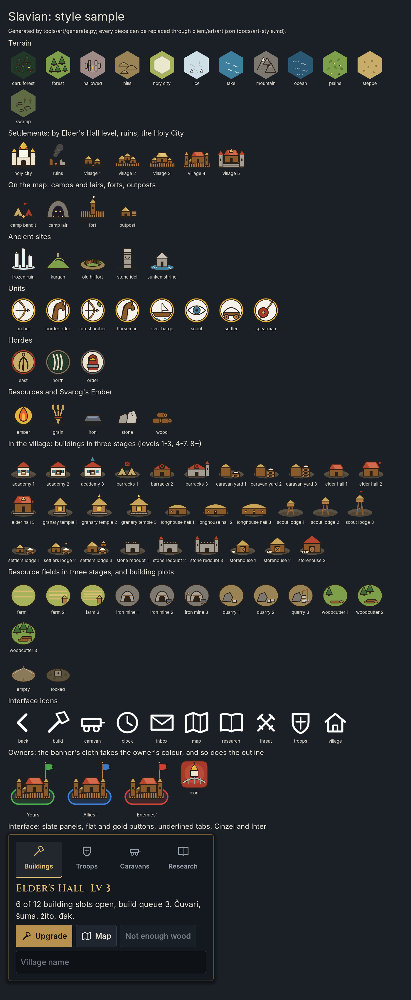

# Art style and replacing art



The first set of art is generated by `tools/art/generate.py` so it is
consistent from the start; any piece can be swapped for your own later.

On the map ([`art/map-sample.png`](art/map-sample.png)): terrain hexes of
one kind merge into regions (lines only where the terrain changes, every other
hex mirrored), settlements show their stage with the owner's banner and ring,
camps and hordes are ringed in red.

## The style

Clean and simple, but distinct: everything should be recognizable at a
glance on a phone, and still look good.

- **One outline for everything:** dark brown `#2b2118`, 4 px at 128 px, round
  joins. Terrain tiles have none (the map draws the grid and will merge
  neighbouring tiles of one kind).
- **Flat fills, one highlight:** each shape has a base colour and one lighter
  highlight; no gradients, no textures.
- **A soft ground shadow** under objects that stand on the map.
- **A shared palette** (`P` in the generator): earth and wood tones, slate
  stone, thatch and red roofs, gold for the sacred (the Holy City's domes,
  Svarog's Ember), cold blues and white for the North.
- **Distinct silhouettes:** a settlement grows from two huts to a walled town
  with a golden dome in five steps (Elder's Hall levels 1–2, 3–4, 5–6, 7–8,
  9–10); camps are tents, lairs are caves with eyes, sites each have their own
  shape.
- **Owners by colour:** a settlement's banner cloth (`banner/cloth`, drawn
  white) and its outline take the owner's colour: green for yours, blue for
  allies', red for enemies'.
- **Village buildings and fields** come in three stages each (levels 1–3,
  4–7, 8+): tents become a longhouse, a palisade a stone keep. Open plots are
  staked out; locked ones are dark and overgrown under a padlock.
- **Units** sit in a gold-ringed medallion; **hordes** have an emblem per
  faction.

## The interface

In the manner of modern grand strategy games (Civilization VI, Old World,
Crusader Kings III): the map is the picture, the interface a quiet frame
around it.

- **Panels** are dark slate glass (`#141920`, slightly see-through) with a thin
  bronze trim, brighter along the top, rounded 8 px, and a soft drop shadow.
- **Buttons** are flat slate with a 1 px line that turns bronze under the
  finger; the main action of a panel is **gold** with dark lettering
  (`UI.primary`). Tabs stay quiet until open, then take a gold underline.
  Icon-only buttons on the top bar have no box until touched.
- **Type:** Cinzel (Roman capitals, a little apart) in gold for headings and
  titles; Inter for everything else, semibold on buttons. Both cover Serbian
  Latin; they live in `client/ui/fonts/` under the SIL Open Font License (the
  licence files sit beside them).
- **Colours:** text `#e9e4d8`, secondary `#9aa3ad`, gold `#e3c27a`, bronze
  `#b8914f`, danger `#e07a62` (the threat line), green/blue/red for owners.
- **Icons** (`icon/...`) are white line drawings, 4.5 px strokes at 64 px with
  round ends; the theme tints them (gold when pressed, dark on gold buttons).
  Resources (`resource/...`) stand in for their names on the top bar and in
  every cost line.
- All of this is vector styles in `client/scripts/ui/ui_theme.gd`, sharp at
  any scale. To draw them as art instead, add `ui/panel`, `ui/button`,
  `ui/button_hover`, `ui/button_pressed`, `ui/button_disabled`,
  `ui/button_selected` (the open tab) or `ui/field` to `art.json`: they are
  nine-sliced, corners kept (panel 24 of 96, buttons 16 of 64, field 12 of 48).
- `ui/title` is the start screen's picture.

## Replacing a piece of art

`client/art/art.json` maps every art id to a file:

```json
"settlement/village_3": "res://art/generated/settlement/village_3.svg",
```

1. Put your file anywhere under `client/art/` outside `generated/`, for
   example `client/art/custom/village_3.png` (SVG or PNG; keep the same
   proportions: 128×128 for most pieces, 128×148 for the pointy-top terrain
   hexes, 160×160 for the Holy City, 64×96 for the banner parts, 192×192 for
   the app icon).
2. Point the id at it: `"settlement/village_3": "res://art/custom/village_3.png"`.
3. Open the project in Godot once (or run `godot --headless --path client
   --import`) so it imports the file.

Running the generator again never touches an id that points outside
`generated/`, so your art stays. Generated SVGs are imported at twice their
size (`svg/scale=2.0` in their `.import` files) so the map stays sharp when
zoomed in; set the same for your SVGs, or give PNGs twice the listed size. Missing art falls back to the game's plain
drawing.

## Tools

- `python3 tools/art/generate.py` writes `client/art/generated/` and adds new
  ids to `art.json`.
- `godot --path client --resolution 1400x3400 --script res://tests/art_sheet.gd -- out.png`
  (with a display, e.g. `xvfb-run`) renders the style sample sheet with the
  game's own renderer.
